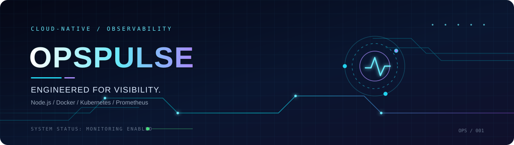
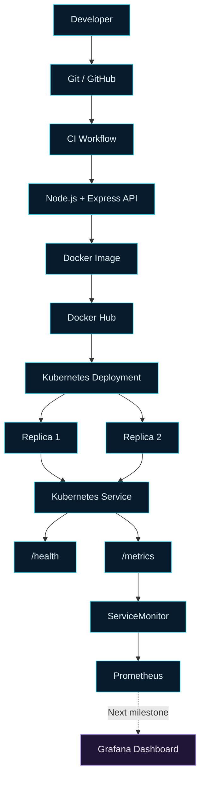

<!-- ==================== OPSPULSE ==================== -->

<div align="center">



<br/>

### `OBSERVE` · `ORCHESTRATE` · `OPTIMIZE`

**A cloud-native DevOps project built from application code to Kubernetes monitoring.**

<br/>

<a href="https://github.com/abbas5665/opspulse">
  
</a>


<br/><br/>

**[Repository](https://github.com/abbas5665/opspulse) · [Issues](https://github.com/abbas5665/opspulse/issues) · [Roadmap](#-mission-roadmap)**

</div>

---

## `01` / SYSTEM OVERVIEW

> **OpsPulse is an evolving cloud-native monitoring project designed to demonstrate practical DevOps engineering workflows.**

Starting with a Node.js API, the project has progressed through containerization, image publishing, Kubernetes orchestration, health checks, and Prometheus integration.

The mission: understand how modern applications are built, deployed, monitored, and operated—not just how individual tools work.

<table>
<tr>
<td width="50%" valign="top">

### ◈ Current capabilities

- Node.js and Express REST API
- Dedicated health endpoint
- Automated test command
- Docker image published to Docker Hub
- Kubernetes Deployment with two replicas
- Kubernetes Service and health probes
- Prometheus client instrumentation
- ServiceMonitor configured
- Prometheus target verified UP

</td>
<td width="50%" valign="top">

### ◈ Engineering objectives

- Container-first application delivery
- Declarative Kubernetes resources
- Application health monitoring
- HTTP request observability
- Metrics-driven troubleshooting
- Repeatable deployment workflows
- Grafana visualization
- Alerting and operational readiness

</td>
</tr>
</table>

## `02` / TECHNOLOGY MATRIX

<div align="center">

| TECHNOLOGY | ROLE IN THE SYSTEM |
|:---|:---|
|  | Application runtime |
|  | HTTP API |
|  | Version control |
|  | CI workflow |
|  | Containerization |
|  | Container orchestration |
|  | Local cluster |
|  | Monitoring stack installation |
|  | Metrics collection |
|  | Planned dashboards |

</div>

## `03` / SYSTEM ARCHITECTURE

<div align="center">



</div>

<sub>Solid paths represent the intended delivery and monitoring flow. Grafana visualization is the next milestone; the complete dashboard has not yet been verified.</sub>

## `04` / API & TELEMETRY

### API endpoints

| Endpoint | Function |
|:---|:---|
| `/` | Application information and version |
| `/health` | Application health check |
| `/metrics` | Prometheus metrics endpoint |

### Custom metrics

**`opspulse_http_requests_total`**

A counter tracking HTTP requests by method, route, and status code.

**`opspulse_http_request_duration_seconds`**

A histogram recording request duration for latency analysis.

**Default process metrics**

Collected through `prom-client` to help inspect Node.js process behavior.

### Example PromQL queries

Request count:

```promql
opspulse_http_requests_total
```

Request rate by route:

```promql
sum by (route) (
  rate(opspulse_http_requests_total[5m])
)
```

95th-percentile request duration:

```promql
histogram_quantile(
  0.95,
  sum by (le) (
    rate(opspulse_http_request_duration_seconds_bucket[5m])
  )
)
```

These queries are intended to inspect collected metrics. Custom metric results still need end-to-end verification.

## `05` / CONTAINER & CLUSTER

### Published container image

```text
abbas5665/opspulse:monitoring-v1
```

Pull and run locally:

```bash
docker pull abbas5665/opspulse:monitoring-v1

docker run --rm -p 3000:3000 \
  abbas5665/opspulse:monitoring-v1
```

Test the endpoints:

```bash
curl http://localhost:3000/
curl http://localhost:3000/health
curl http://localhost:3000/metrics
```

### Kubernetes operations

Inspect the deployment:

```bash
kubectl get nodes
kubectl get deployments
kubectl get pods -l app=opspulse
kubectl get services
kubectl get endpoints opspulse-service
```

Access the service through local port forwarding:

```bash
kubectl port-forward svc/opspulse-service 3000:3000
```

Then open `http://localhost:3000/health`.

### Monitoring configuration

The Prometheus monitoring stack was installed with Helm using the `kube-prometheus-stack` chart.

The `opspulse` ServiceMonitor selects the application Service and configures scraping of `/metrics` every 15 seconds.

The Prometheus target has been confirmed **UP**. Application metric queries and dashboard visualizations remain to be verified.

## `06` / REPOSITORY STRUCTURE

```text
opspulse/
├── .github/
│   └── workflows/
├── assets/
│   └── opspulse-banner.svg
├── k8s/
│   ├── deployment.yaml
│   ├── service.yaml
│   └── servicemonitor.yaml
├── app.js
├── server.js
├── package.json
├── package-lock.json
├── Dockerfile
└── README.md
```

The workflow directory may contain additional files. This is the intended high-level layout; verify it against the actual repository before treating it as exhaustive.

## `07` / MISSION ROADMAP

- [x] Build the Node.js API
- [x] Add health and metrics endpoints
- [x] Configure the automated test command
- [x] Containerize the application
- [x] Publish the Docker image
- [x] Maintain the source code in GitHub
- [x] Deploy two Kubernetes replicas
- [x] Configure service networking and health probes
- [x] Install the Prometheus monitoring stack
- [x] Configure the ServiceMonitor
- [x] Verify the Prometheus target is UP
- [ ] Verify custom metrics are collected
- [ ] Build a Grafana dashboard
- [ ] Configure useful alerts
- [ ] Improve image publishing automation
- [ ] Explore infrastructure as code
- [ ] Deploy to a cloud environment

## `08` / RUN TESTS

Run the configured project test script:

```bash
npm test
```

Inspect application health:

```bash
curl -s http://localhost:3000/health
```

Inspect exposed metrics:

```bash
curl -s http://localhost:3000/metrics
```

Use the appropriate port-forward or container port for your current environment.

## `09` / ENGINEERING PRINCIPLES

- **Automation:** Prefer repeatable workflows over manual repetition.
- **Observability:** Make application behavior measurable.
- **Resilience:** Use health probes and multiple replicas.
- **Reproducibility:** Keep configuration and deployment manifests under version control.
- **Security:** Avoid committing credentials or exposing monitoring services unnecessarily.
- **Continuous learning:** Document what works, what fails, and what is improved.

## `10` / PROJECT IDENTITY

<div align="center">

**ABBAS KAZMI**

Aspiring DevOps Engineer · Linux · Docker · CI/CD · Kubernetes · Cloud

[](https://github.com/abbas5665)
[](https://github.com/abbas5665/opspulse)

*Built through hands-on experimentation, troubleshooting, and continuous improvement.*

**SYSTEM EVOLVING // OBSERVABILITY IN PROGRESS**

</div>

<!-- ================= END OPSPULSE ================= -->
